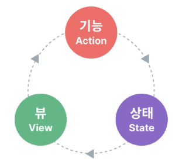
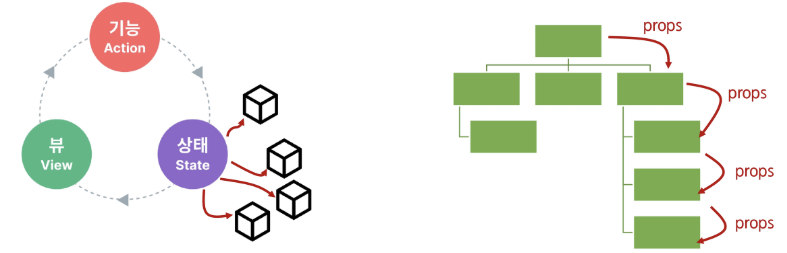
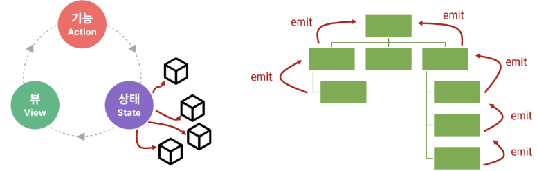
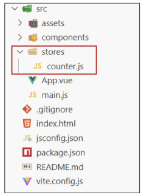
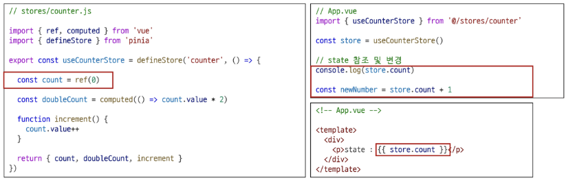
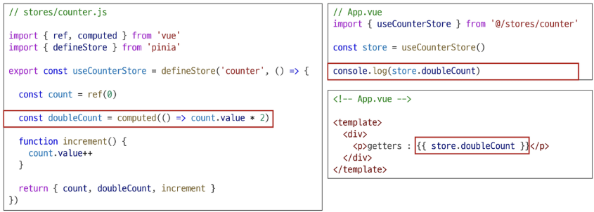
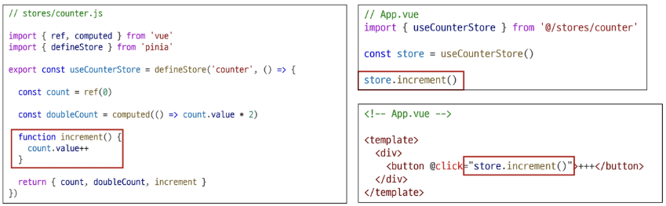
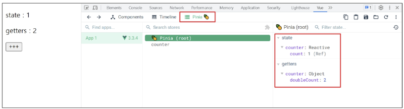
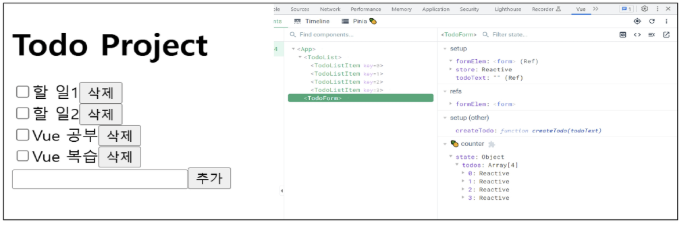
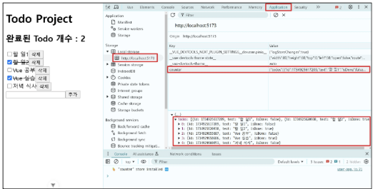

# 📘 목차 (Table of Contents)
### 1. State Management

### 2. State management library (Pinia)
- Pinia
- Pinia 구조
- Pinia 구성 요소 활용

### 3. Pinia 실습
- 사전준비
- Todo 조회(Read)
- Todo 생성(Create)
- Todo 삭제(Delete)
- Todo 수정(Update)
- 수정과 삭제 구현 방식
- Todo 카운팅
- Local Storage

### 참고
- Pinia 활용 시점


---


# 학습 목표
✓ Props와 Emit 방식의 상태 관리 문제점을 설명할 수 있다.

✓ Pinia의 state, getters, actions의 역할을 이해한다.

✓ defineStore 함수를 사용해 중앙 저장소(store)를 정의한다.

✓ 컴포넌트에서 Pinia store를 호출하여 상태를 사용할 수 있다.

✓ 컴포넌트에서 store의 action을 호출해 state를 변경한다.

✓ store의 getters를 활용하여 계산된 값을 얻을 수 있다.

✓ Pinia 플러그인을 사용해 상태를 Local Storage에 저장한다.


---


# ✅ State Management

## 🔵 Vue의 컴포넌트 구조 (1/2)
- 상태(State), 뷰(View), 기능(Actions)은 **“단방향 데이터 흐름”** 으로 상호작용하고 있음
- 컴포넌트 구성요소
    - **상태(State)**
        - 앱 구동에 필요한 기본 데이터

    - **뷰(View)**
        - 상태를 선언적으로 매핑하여 시각화

    - **기능(Actions)**
        - 뷰에서 사용자 입력에 대해 반응적으로 상태를 변경할 수 있게 정의된 동작

```vue
<template>
    <!-- 뷰(View) -->
    <div>{{ count }}</div>
</template>

<script setup>
import { ref } from 'vue'

// 상태(State)
const count = ref(0)

// 기능(Actions)
const increment = function () {
    count.value++
}
</script>
```




## 🔵 상태 관리의 단순성(단방향 데이터 흐름)이 무너지는 시점 (1/3)

- 여러 컴포넌트가 상태를 공유할 때
    1. 여러 뷰가 동일한 상태에 종속되는 경우
    2. 서로 다른 뷰의 기능이 동일한 상태를 변경시켜야 하는 경우


## 🔵 상태 관리의 단순성(단방향 데이터 흐름)이 무너지는 시점 (2/3)
1. 여러 뷰가 동일한 상태에 종속되는 경우
    -  공유 상태를 공통 조상 컴포넌트로 "끌어올린" 다음, props로 여러 컴포넌트에 전달하는 방법

    - 하지만 컴포넌트 계층 구조가 깊어질수록 이 방식은 비효율적이고 관리가 어려워 짐

> **props** : 부모 컴포넌트가, 자식 컴포넌트에게 데이터를 전달하는 통로




## 🔵 상태 관리의 단순성(단방향 데이터 흐름)이 무너지는 시점 (3/3)
2. 서로 다른 뷰의 기능이 동일한 상태를 변경시켜야 하는 경우

    -  발신(emit)된 이벤트를 통해 상태의 여러 복사본을 변경 및 동기화 하는 것
    -  마찬가지로 관리의 패턴이 깨지기 쉽고 유지 관리할 수 없는 코드가 됨

> **emit** : 자식 컴포넌트가, 부모에게 알리는 신호.




## 🔵 해결 방법 (1/2)

- 각 컴포넌트의 공유 상태를 추출하여, 전역에서 참조할 수 있는 저장소에서 관리
-  그리고 이 저장소의 역할을 하는 것이 “Pinia”
    
    ### => Pinia   ==   중앙 저장소


## 🔵 해결 방법 (2/2)
-  “Pinia”는 Vue의 공식 상태 관리 라이브러리
-  컴포넌트 트리는 하나의 큰 View가 되고 모든 컴포넌트는 트리 계층 구조에 관계 없이 상태에 접근하거나 기능을 사용할 수 있음


---


# ✅ Pinia

## 🔵 Pinia 란?   
- Vue 공식 상태 관리 라이브러리

```
- Pinia는 여러 컴포넌트가 함께 사용해야 하는 공통 데이터를 중앙 저장소에서의 통합 관리를 도와주는 Vue의 공식 상태 관리 라이브러리입니다.
- Props나 emit으로 복잡하게 데이터를 전달할 필요 없이, 어떤 컴포넌트든 이 중앙 저장소에 직접 접근하여 데이터를 읽거나 수정할 수 있습니다.
```


## 🔵 Pinia 설치하기
- Vite 프로젝트 빌드 시 Pinia 라이브러리 추가
> **Vite** : 빠른 개발 환경을 위한 빌드 도구와 개발 서버를 제공하는 프론트 엔드 개발 툴


## 🔵 Pinia 설치 후 Vue 프로젝트 구조 변화 살펴보기
- stores 폴더 신규 생성

    


---


# ✅ Pinia 구성 요소


## 🔵 Pinia 구성 요소 (6가지)

1. store  
2. state  
3. getters  
4. actions  
5. 반환 값  
6. plugin


## 🔵 1. Pinia 구성 요소: **store**
- 공통 데이터를 관리하는 중앙 저장소
- 모든 컴포넌트가 공유하는 상태이며, 기능이 작성됨

    ➤ defineStore()의 반환 값(store)을 담는 변수의 이름은 use...Store 패턴을 사용하는 것을 권장합니다.
   (예: useCounterStore)

    ➤ **defineStore()의 첫번째 인자**는 애플리케이션 전체에 걸쳐 사용하는 **store의 고유 ID**

```js
// stores/counter.js

import { ref, computed } from 'vue'
import { defineStore } from 'pinia'

export const useCounterStore = defineStore('counter', () => {  ⭐

    const count = ref(0)

    const doubleCount = computed(() => count.value * 2)

    function increment() {
        count.value++
    }

    return { count, doubleCount, increment }
})
```


## 🔵 2. Pinia 구성 요소: **state**
- 중앙 저장소에 저장되는 반응형 상태(데이터)
- 해당 값(count)을 변경하면, 이 데이터를 사용하고 있는 모든 컴포넌트의 화면은 알아서 업데이트 됨
- **ref()** 와 같은 역할을 함

```js
// stores/counter.js

import { ref, computed } from 'vue'
import { defineStore } from 'pinia'

export const useCounterStore = defineStore('counter', () => {

    const count = ref(0)  ⭐

    const doubleCount = computed(() => count.value * 2)

    function increment() {
        count.value++
    }

    return { count, doubleCount, increment }
})
```

> **ref()** : 기본형 데이터를 반응형으로 만드는 Vue 함수  


## 🔵 3. Pinia 구성 요소: **getters**
- 계산된 값
- state를 기반으로 파생된 값을 정의하는 것
- **computed()** 와 똑같은 역할을 함

```js
// stores/counter.js

import { ref, computed } from 'vue'
import { defineStore } from 'pinia'

export const useCounterStore = defineStore('counter', () => {

    const count = ref(0)

    const doubleCount = computed(() => count.value * 2) ⭐

    function increment() {
        count.value++
    }

    return { count, doubleCount, increment }
})
```

> **computed()** : 원본 데이터가 바뀔 때만, 값을 알아서 다시 계산하는 ref


## 🔵 4. Pinia 구성 요소: **actions**
- state를 변경하는 역할
- methods와 같은 역할을 함

```js
// stores/counter.js

import { ref, computed } from 'vue'
import { defineStore } from 'pinia'

export const useCounterStore = defineStore('counter', () => {

  const count = ref(0)

  const doubleCount = computed(() => count.value * 2)
  
  function increment() {  ⭐
    count.value++
  }

  return { count, doubleCount, increment }
})
```

> **methods** : 클릭 같은 이벤트에 반응해, 특정 로직을 실행시키는 함수


## 🔵 5. Pinia 구성 요소: 반환 값
- pinia의 상태들을 사용하려면 반드시 반환해야 함
- store에서는 공유 하지 않는 **private한 상태 속성을 가지지 않음**

```js
// stores/counter.js

import { ref, computed } from 'vue'
import { defineStore } from 'pinia'

export const useCounterStore = defineStore('counter', () => {

  const count = ref(0)

  const doubleCount = computed(() => count.value * 2)

  function increment() {
    count.value++
  }

  return { count, doubleCount, increment }  ⭐
})
```


## 🔵 6. Pinia 구성 요소: plugin
- 애플리케이션의 상태 관리에 필요한 추가 기능을 제공하거나 확장하는 도구나 모듈
- 애플리케이션의 상태 관리를 더욱 간편하고 유연하게 만들어주며, 패키지 매니저로 설치 이후 별도 설정을 통해 추가 됨
- 예)
    - 모든 스토어의 상태를 자동으로 **localStorage**에 저장하고 복원해주는 플러그인
    - 해당 플러그인을 등록하면, 스토어의 state 값이 변경될 때마다 자동으로 브라우저의 localstorage에 저장 됨
    - 그로 인해, 페이지를 새로고침해도 값이 초기화되지 않고 유지


---


# ✅ Pinia 구성 요소 활용


## 🔵 Pinia 구성 요소 활용: state
- 각 컴포넌트 깊이에 관계 없이 store 인스턴스로 state에 접근하여 직접 읽고 쓸 수 있음
- 만약 store에 state를 정의하지 않았다면 컴포넌트에서 새로 추가할 수 없음

    


## 🔵 Pinia 구성 요소 활용: getters
- store의 모든 getters 또한 state처럼 직접 접근 할 수 있음

    


## 🔵 Pinia 구성 요소 활용: Actions
- store의 모든 actions 또한 직접 접근 및 호출 할 수 있음
- getters와 달리 state 조작, 비동기, API 호출이나 다른 로직을 진행할 수 있음

    


## 🔵 Vue devtools로 Pinia 구성 요소 확인하기



---


# ✅ Pinia 실습

## 🔵 Pinia를 활용한 Todo 프로젝트 구현
1. Todo CRUD 구현  
2. Todo 개수 계산  
   - 완료된 Todo 개수


---


# ✅ 사전 준비

## 🔵 사전 준비 (1/4)
- 초기 생성된 컴포넌트 모두 삭제 (App.vue 제외)  
- src/assets 내부 파일 모두 삭제  
- main.js 해당 코드 삭제 ( import './assets/main.css' )

```js
// main.js
import { createApp } from 'vue'
import { createPinia } from 'pinia'
import App from './App.vue'

const app = createApp(App)

app.use(createPinia())

app.mount('#app')
```


## 🔵 사전 준비 (2/4)
- TodoListItem 컴포넌트와 TodoList 컴포넌트를 작성  
- TodoListItem 컴포넌트를 TodoList 컴포넌트에 등록

```js
<!-- TodoListItem.vue -->
<template>
  <div>
    TodoListItem
  </div>
</template>

<!-- TodoList.vue -->
<template>
  <div>
    <TodoListItem />
  </div>
</template>

<script setup>
import TodoListItem from '@/components/TodoListItem.vue'
</script>
```


## 🔵 사전 준비 (3/4)
- TodoForm 컴포넌트 작성  
- App 컴포넌트에 TodoList, TodoForm 컴포넌트 등록

```js
<!-- TodoForm.vue -->
<template>
  <div>
    TodoForm
  </div>
</template>

<!-- App.vue -->
<template>
  <div>
    <h1>Todo Project</h1>
    <TodoList />
    <TodoForm />
  </div>
</template>

<script setup>
import TodoForm from '@/components/TodoForm.vue'
import TodoList from '@/components/TodoList.vue'
</script>
```


## 🔵 사전 준비 (4/4)
- 컴포넌트 구성 확인


---


# ✅ Todo 조회(Read)


## 🔵 Todo 조회 (1/3)
- store에 임시 todos 목록 state를 정의

```js
// stores/counter.js

import { ref, computed } from 'vue'
import { defineStore } from 'pinia'

export const useCounterStore = defineStore('counter', () => {
  let id = 0

  const todos = ref([
    { id: id++, text: '할 일 1', isDone: false },
    { id: id++, text: '할 일 2', isDone: false }
  ])

  return { todos }
})
```


## 🔵 Todo 조회 (2/3)
- store의 todos state를 참조
- 하위 컴포넌트인 TodoListItem을 반복 하면서 개별 todo를 props로 전달

```js
// TodoList.vue

import TodoListItem from '@/components/TodoListItem.vue'
import { useCounterStore } from '@/stores/counter'

const store = useCounterStore()
```
```html
<!-- TodoList.vue -->
<template>
    <div>
        <TodoListItem
            v-for="todo in store.todos"
            :key="todo.id"
            :todo="todo"
        />
    </div>
</template>
```


## 🔵 Todo 조회 (3/3)
- props 정의 후 데이터 출력 확인

```html
<!-- TodoListItem.vue -->

<template>
    <div>
        <input type="checkbox" name="todo-text">
        <label for="todo-text">{{ todo.text }}</label>
        <button>삭제</button>
    </div>
</template>

<script setup>
defineProps({
    todo: Object
})
</script>
```


---


# ✅ Todo 생성(Create)


## 🔵 Todo 생성 (1/6)
- todos 목록에 todo를 생성 및 추가하는 addTodo 액션 정의

```js
// stores/todo.js

const addTodo = function (todoText) {
    todos.value.push({
        id: id++,
        text: todoText,
        isDone: false
    })
}

return { todos, addTodo }
```


## 🔵 Todo 생성 (2/6)
- TodoForm에서 실시간으로 입력되는 사용자 데이터를 양방향 바인딩하여 반응형 변수로 할당
```js
// TodoForm.vue

import { ref } from 'vue'

const todoText = ref('')
```
```html
<!-- TodoForm.vue -->

<template>
    <div>
        <form>
            <input type="text" v-model="todoText">
            <input type="submit">
        </form>
    </div>
</template>
```


## 🔵 Todo 생성 (3/6)
- submit 이벤트가 발생 했을 때 사용자 입력 텍스트를 인자로 전달하여 store에 정의한 addTodo 액션 메서드를 호출

```js
// TodoForm.vue

import { useCounterStore } from '@/stores/counter'

const store = useCounterStore()

const createTodo = function (todoText) {
    store.addTodo(todoText)
}
```
```html
<!-- TodoForm.vue -->
<template>
    <div>
        <form @submit.prevent="createTodo(todoText)">
            <input type="text" v-model="todoText">
            <input type="submit">
        </form>
    </div>
</template>
```


## 🔵 Todo 생성 (4/6)
- form 요소를 선택하여 todo 입력 후 input 데이터를 초기화 할 수 있도록 처리

```html
<!-- TodoForm.vue -->

<form @submit.prevent="createTodo(todoText)" ref="formElem">
    <input type="text" v-model="todoText">
    <input type="submit">
</form>
```
```js
// TodoForm.vue

const formElem = ref(null)

const createTodo = function (todoText) {
    store.addTodo(todoText)
    formElem.value.reset()
}
```


## 🔵 Todo 생성 (5/6)
- 결과 확인
    


## 🔵 Todo 생성 (6/6)
- store 의 addTodo 액션을 직접 호출해도 되지만, 굳이 createTodo를 만들어서 호출하는 이유

    ➤ addTodo 호출 전후로 추가 로직을 작성할 수 있기 때문

```js
<!-- TodoForm.vue -->
<form @submit.prevent="store.addTodo(todoText)">
```
```html
<!-- TodoForm.vue -->
<form @submit.prevent="createTodo(todoText)" ref="formElem">
  <input type="text" v-model="todoText">
  <input type="submit">
</form>
```
```js
const createTodo = function (todoText) {
  store.addTodo(todoText)
  formElem.value.reset()
}
```


---


# ✅ Todo 삭제(Delete)

## 🔵 Todo 삭제 (1/5)
- todos 목록에서 특정 todo를 삭제하는 deleteTodo 액션 정의

```js
// stores/counter.js
const deleteTodo = function () {
  console.log('delete')
}

return { todos, addTodo, deleteTodo }
```


## 🔵 Todo 삭제 (2/5)
- 각 todo에 버튼을 클릭하면 선택된 todo의 id를 인자로 전달해 deleteTodo 메서드 호출
-deleteTodo 메서드는 전달 받은 인자를 store의 deleteTodo에게 전달하며 호출

```html
<!-- TodoListItem.vue -->
<div>
  <input type="checkbox" name="todo-text">
  <label for="todo-text">{{ todo.text }}</label>
  <button @click="deleteTodo(todo.id)">삭제</button>
</div>
```
```js
// TodoListItem.vue
import { useCounterStore } from '@/stores/counter'

const store = useCounterStore()

const deleteTodo = function (selectedId) {
  store.deleteTodo(selectedId)
}
```


## 🔵 Todo 삭제 (3/5)
- store의 deleteTodo에 삭제 로직 구현
- 삭제 방법 1
    - findIndex를 활용해 하나만 찾아서 삭제
- 삭제 방법 2
    - filter로 삭제하지 않아도 되는 것들만 모아서 재생성

    ➤ 위 방법 중 하나로 삭제를 구현한 후 결과 확인하기


## 🔵 Todo 삭제 (4/5)
- 삭제 방법 1
    - findIndex를 활용해 하나만 찾아서 삭제
    - 인덱스를 찾은 뒤 해당 위치에서 1개만 제거

```js
// stores/counter.js

const deleteTodo = function (selectedId) {
    const index = todos.value.findIndex((todo) => todo.id === selectedId)
    todos.value.splice(index, 1)
}

return { todos, addTodo, deleteTodo }
```


## 🔵 Todo 삭제 (5/5)
- 삭제 방법 2
    - filter로 삭제하지 않아도 되는 것들만 모아서 재생성

```js
// stores/counter.js

const deleteTodo = function (selectedId) {
    todos.value = todos.value.filter(todo => todo.id !== selectedId)
}

return { todos, addTodo, deleteTodo }
```


---


# ✅ Todo 수정(Update)


## 🔵 Todo 수정 (1/7)
- (목표) 각 todo 상태의 isDone 속성을 변경하여 todo의 완료 유무를 처리하기
- (목표) 완료된 todo에는 취소선 스타일 적용하기
- todos 목록에서 특정 todo의 isDone 속성을 변경하는 updateTodo 액션 정의

```js
// stores/counter.js

const updateTodo = function () {
    console.log('update')
}

return { todos, addTodo, deleteTodo, updateTodo }
```


## 🔵 Todo 수정 (2/7)
- 체크박스 클릭 ⇒ isDone ref 변경 ⇒ watch 감지 ⇒ store.updateTodo 호출

```js
<!-- TodoListItem.vue -->

<div>
    <input type="checkbox" name="todo-text" v-model="isDone">
    <label for="todo-text">{{ todo.text }}</label>
    <button @click="deleteTodo(todo.id)">삭제</button>
</div>
```
```js
// TodoListItem.vue
const isDone = ref(props.todo.isDone)
```


## 🔵 Todo 수정 (3/7)
- 체크박스 클릭 ⇒ isDone ref 변경 ⇒ **watch 감지 ⇒ store.updateTodo 호출**

```js
// TodoListItem.vue
import { ref, watch } from 'vue'

watch(isDone, () => {
    store.updateTodo(props.todo.id)
})
```


## 🔵 Todo 수정 (4/7)
- store의 updateTodo에 수정 로직 구현
- 수정 방법 1
    - forEach를 활용해 하나만 찾아서 수정
- 수정 방법 2
    - map을 활용해 수정해야 하는 항목을 찾아서 수정하고, 수정한 객체를 사용


## 🔵 Todo 수정 (5/7)
- 수정 방법 1  
    - forEach를 활용해 하나만 찾아서 수정  
    - 순회 도중 일치 항목 찾으면 직접 속성 변경

```js
// stores/counter.js
const updateTodo = function (selectedId) {
  todos.value.forEach((todo) => {
    if (todo.id === selectedId) {
      todo.isDone = !todo.isDone
    }
  })
}

return { todos, addTodo, deleteTodo }
```


## 🔵 Todo 수정 (6/7)
- 수정 방법 2
    - forEach를 활용해 하나만 찾아서 수정
    - 모든 항목을 순회하며, ID가 일치하면 새 객체를 리턴

```js
// stores/counter.js

const updateTodo = function (selectedId) {
 todos.value = todos.value.map((todo) => {
  if (todo.id === selectedId) {
   todo.isDone = !todo.isDone
  }
  return todo
 })
}
```


## 🔵 Todo 수정 (7/7)
- todo 객체의 isDone 속성 값에 따라 스타일 바인딩 적용 후 결과 확인
```js
// TodoListItem.vue

<style scoped>
.is-done {
    text-decoration: line-through;
}
</style>
```
```js
// TodoListItem.vue

<label
    for="todo-text"
    :class="{ 'is-done': todo.isDone }"
>{{ todo.text }}</label>
```


---


# ✅ 수정과 삭제 구현 방식


## 🔵 수정과 삭제 구현에 대한 2가지 관점
- In-place 방식 (하나만 수정/삭제)
    - 배열 전체 재생성 없이 필요한 항목만 바로 수정 또는 제거
- 전체 배열 재생성 방식
    - 배열을 순회하면서 특정 조건을 만족하지 않으면 누락하거나, 필요한 변경 사항만 반영해 새로운 배열을 만든 뒤 기존 배열에 재할당

➤ 두 가지 접근 모두 성능과 가독성 면에서 큰 차이가 없는 경우가 많지만, 프로젝트나 팀 컨벤션에 따라
 방식이 달라질 수 있음

➤ 중요한 것은, 무엇을 의도하고 있는지(단일 항목 수정/삭제 vs. 전체 재생성)를 **명확히 알고 선택**하는 것


---


# ✅ Todo 카운팅


## 🔵 완료된 todo 개수 계산 (1/2)
- todos 배열의 길이 값을 반환하는 함수 doneTodosCount 작성 (getters)

```js
// stores/counter.js
const doneTodosCount = computed(() => {
    const doneTodos = todos.value.filter((todo) => todo.isDone)

    return doneTodos.length
})

return { todos, addTodo, deleteTodo, updateTodo, doneTodosCount }
```


## 🔵 완료된 todo 개수 계산 (2/2)
- App 컴포넌트에서 doneTodosCount getter를 참조

```js
// App.vue
import { useCounterStore } from '@/stores/counter'

const store = useCounterStore()
```
```html
<!-- App.vue -->
<div>
    <h1>Todo Project</h1>
    <h2>완료된 Todo 개수 : {{ store.doneTodosCount }}</h2>
    <TodoList />
    <TodoForm />
</div>
```


---


# ✅ Local Storage


## 🔵 Local Storage 란?
- 브라우저 내에 key-value 쌍을 저장하는 웹 스토리지 객체

- Local Storage는 웹 브라우저에 데이터를 영구적으로 저장할 수 있는 ‘개인 하드디스크’ 같은 공간입니다.
- 여기에 저장된 데이터는 사용자가 직접 삭제하지 않는 한, 브라우저를 껐다 켜거나 컴퓨터를 재부팅해도 사라지지 않고 그대로 남아있습니다.
- 주로 사용자의 설정(예: 다크 모드, 언어) 등 서버와 상관없이 브라우저에만 기억해두면 되는 정보를 저장하는 데 사용됩니다.


## 🔵 Local Storage 특징
- 페이지를 새로 고침하고 브라우저를 다시 실행해도 데이터가 유지
- 쿠키와 다르게 네트워크 요청 시 서버로 전송되지 않음
- 여러 탭이나 창 간에 데이터를 공유 할 수 있음

> **쿠키** : 서버가 사용자를 기억하려고, 브라우저에 남기는 정보


## 🔵 Local Storage 사용 목적
- 웹 애플리케이션에서 사용자 설정, 상태 정보, 캐시 데이터 등을 클라이언트 측에서 보관하여 웹사이트의 성능을 향상시키고 사용자 경험을 개선하기 위함


## 🔵 pinia-plugin-persistedstate
- Pinia의 플러그인(plugin) 중 하나
- 웹 애플리케이션의 상태(state)를 브라우저의 local storage나 session storage에 영구적으로 저장하고 복원하는 기능을 제공

https://prazdevs.github.io/pinia-plugin-persistedstate/


## 🔵 pinia-plugin-persistedstate 설정 (1/3)
- npm 설치 및 등록 ( `$ npm i pinia-plugin-persistedstate` )

```js
// main.js

import piniaPluginPersistedstate from 'pinia-plugin-persistedstate'

const app = createApp(App)
const pinia = createPinia()

pinia.use(piniaPluginPersistedstate)

// app.use(createPinia())
app.use(pinia)

app.mount('#app')
```


## 🔵 pinia-plugin-persistedstate 설정 (2/3)
- defineStore()의 3번째 인자로 관련 객체 추가
```js
// stores/counter.js

export const useCounterStore = defineStore('counter', () => {
  …
  return { todos, addTodo, deleteTodo, updateTodo, doneTodosCount }
}, { persist: true })
```


## 🔵 pinia-plugin-persistedstate 설정 (3/3)
- 적용 결과 (개발자도구 → Application → Local Storage)
    - 브라우저의 Local Storage에 저장되는 todos state 확인
    


---


# ✅ Pinia 활용 시점


## 🔵 이제 모든 데이터를 store에서 관리해야 할까?
- Pinia를 사용한다고 해서 모든 데이터를 state에 넣어야 하는 것은 아님
    
    ➤ 컴포넌트 내부에서만 사용하는 데이터까지 Pinia로 관리하면, **코드가 불필요하게 복잡해짐**

- pass props, emit event를 함께 사용하여 애플리케이션을 구성해야 함

    ➤ 단순한 부모-자식 데이터 전달은 Pinia보다 props가 더 간단하고 직관적인 방법

➤ 상황에 따라 적절하게 사용하는 것이 필요


## 🔵 그러면 Pinia, 언제 사용해야 할까?
- Pinia는 공유된 상태를 관리하는 데 유용하지만,
구조적인 개념을 이해하고 시작하는 비용이 큼
- 애플리케이션이 **단순하다면 Pinia가 없는 것**이 더 효율적일 수 있음
- 그러나 중대형 규모의 SPA를 구축하는 경우 Pinia는 자연스럽게 선택할 수 있는 단계가 오게 됨
- 결과적으로 적절한 상황에서 활용했을 때 Pinia 효용을 극대화할 수 있음


---


# 📚 총 정리

## 🔑 핵심 키워드
| 개념            | 설명                          | 예시                                  |
| ------------- | --------------------------- | ----------------------------------- |
| 상태 관리         | 여러 컴포넌트의 공유 상태를 관리          | Props, emit 혹은 중앙 저장소 사용            |
| Pinia         | Vue의 공식 상태 관리 라이브러리         | 중앙 저장소(store)를 제공                   |
| defineStore   | 중앙 저장소(store)를 정의하는 함수      | `defineStore('counter', () => {})`  |
| state         | 중앙 저장소의 반응형 데이터             | `const count = ref(0)`              |
| getters       | state를 기반으로 한 계산된 속성        | `const double = computed(() => {})` |
| actions       | state를 변경하는 메서드             | `function increment() {}`           |
| 상태 유지 (Pinia) | Pinia 상태를 Local Storage에 저장 | `{ persist: true }` 옵션 사용           |


---


## 📝 요약 및 정리
### Pinia
- Vue의 공식 상태 관리 라이브러리로, 컴포넌트들이 공유하는 상태를 관리하기 위한 중앙 저장소(store)를 제공
- Pinia를 사용하면 어떤 컴포넌트든 props나 emit 없이 중앙 저장소에 직접 접근하여 상태를 읽거나 변경 가능
- defineStore() 함수를 사용해 store를 정의하며, store는 세 가지 핵심 요소로 구성됨
- **state**
    - ref()로 정의된 반응형 데이터로, 여러 컴포넌트가 공유하는 상태의 원본

- **getters**
    - computed()로 정의되며, state를 기반으로 하는 계산된 값으로 state 원본에 의존하기 때문에 캐싱(caching) 기능 존재

- **actions**
    - function으로 정의되며, state를 변경하는 메서드이며 비동기 로직 포함 가능


### State Persistence
- Pinia의 상태는 기본적으로 메모리에 저장되므로, 페이지를 새로고침하면 초기화됨

- pinia-plugin-persistedstate
    - Pinia의 상태를 브라우저의 Local Storage에 자동으로 저장하여 새로고침해도 데이터가 유지되도록 하는 플러그인

-  Local Storage
    - 브라우저를 닫았다 열어도 데이터가 사라지지 않는 영구적인 웹 스토리지 객체
    - 플러그인을 설치하고 main.js에 등록한 후, defineStore()의 세 번째 인자로 { persist: true } 옵션을 추가하면 해당 store의 상태가 자동으로 Local Storage에 저장됨


---


### Props는 훌륭한 도구지만, 컴포넌트 구조가 5단계 이상 깊어진다면 어떨까요?
- 데이터를 전달하기 위해 모든 중간 컴포넌트를 거쳐야 하는 건 매우 복잡함

➡ 우리는 Pinia라는 중앙 저장소를 활용해 문제 해결 방법을 학습했고, 이를 통해 컴포넌트 구조에 얽매이지 않고 앱 전체의 상태를 일관되고 효율적으로 관리하는 방법을 배웠음.
```js
import { useCounterStore } from '@/stores/counter'
const store = useCounterStore()

// 이제 store.count, store.increment() 등으로 직접 접근!
```