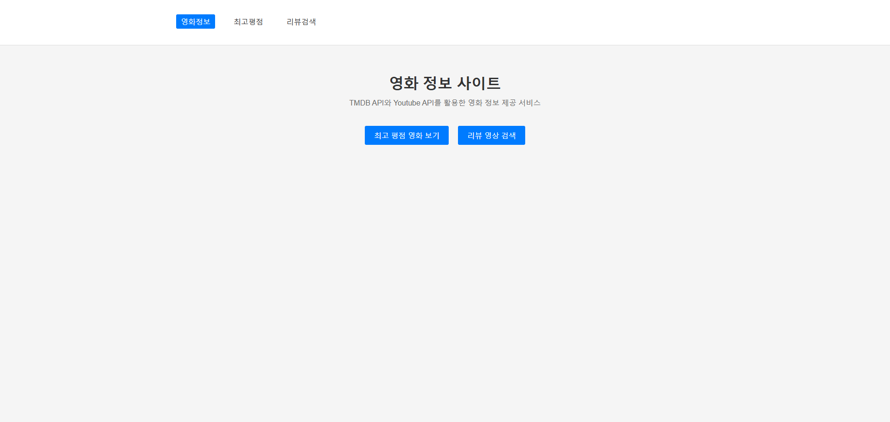
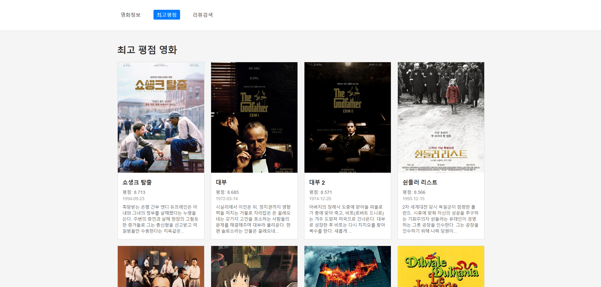
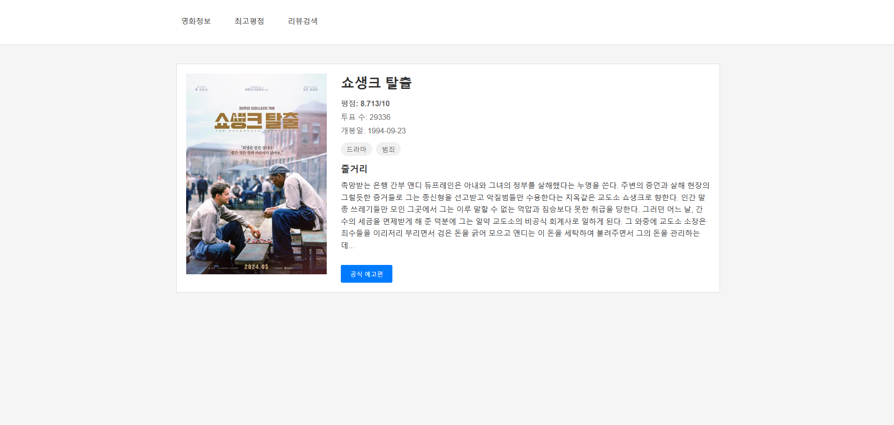
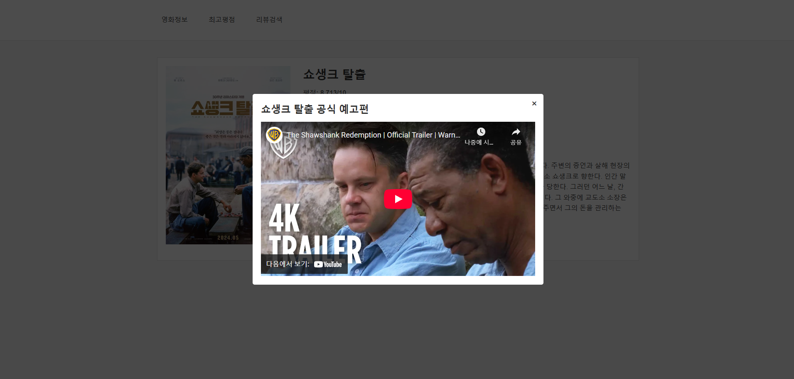
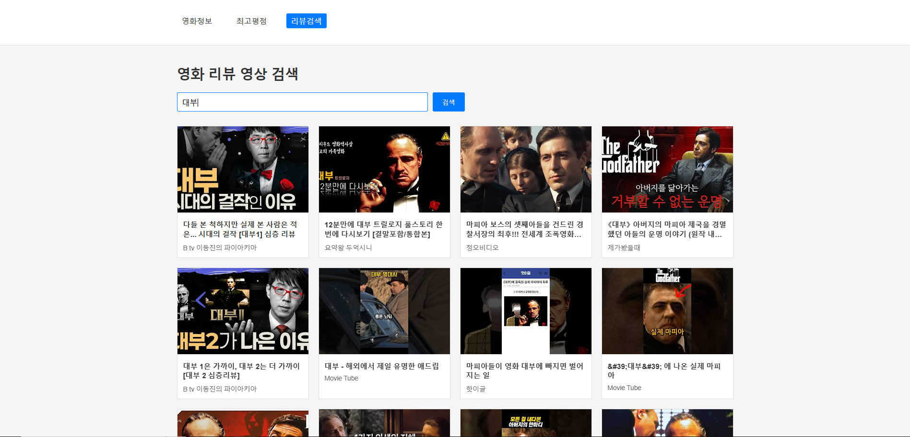
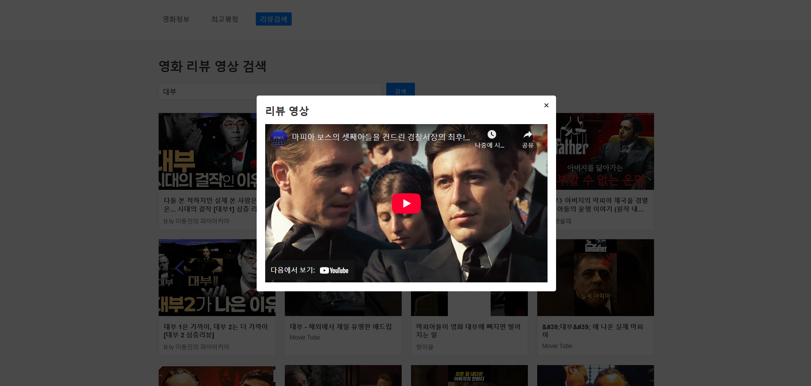

# 🎬 11-pjt : Vue를 활용한 SPA 구성 기초


## 📌 프로젝트 개요

이 프로젝트는 Vue 3와 외부 API를 활용하여 정보 제공을 목표로 하는 SPA(Single Page Application)를 제작하는 것을 목표로 합니다. TMDB API를 통해 영화 정보를 가져오고, Youtube API를 활용하여 영화 예고편 및 리뷰 영상을 시청할 수 있는 기능을 제공합니다.

---

## ⚙️ 주요 기능

| 요구사항 번호 | 기능명                  | 설명                                                |
| ---------- | -------------------- | ------------------------------------------------- |
| F01 | 최고 평점 영화 조회 | TMDB API를 활용하여 평점 순으로 정렬된 영화 목록 출력 |
| F02 | 영화 상세 정보 조회 | 특정 영화의 상세 정보를 출력하는 페이지 구현 |
| F03 | 영화 예고편 조회 | 특정 영화의 공식 예고편을 모달 UI를 통해 재생하는 기능 구현 |
| F04 | 영화 리뷰 영상 검색 | 영화 제목을 바탕으로 영화 리뷰 영상을 검색하는 페이지 구현 |
| F05 | 영화 리뷰 영상 조회 | 특정 리뷰 영상을 모달 UI를 통해 재생하는 기능 구현 |

---

## 📋 구현 기능 및 기술

### 프로젝트 구조

```
movie-project/
├── src/
│   ├── components/
│   │   ├── MovieCard.vue              # 영화 카드 컴포넌트
│   │   ├── MovieDetailInfo.vue        # 영화 상세 정보 컴포넌트
│   │   ├── YoutubeCard.vue            # 유튜브 영상 카드 컴포넌트
│   │   ├── YoutubeTrailerModal.vue    # 예고편 모달 컴포넌트
│   │   └── YoutubeReviewModal.vue     # 리뷰 영상 모달 컴포넌트
│   ├── views/
│   │   ├── HomeView.vue               # 메인 페이지
│   │   ├── MovieListView.vue          # 영화 목록 페이지
│   │   ├── MovieDetailView.vue        # 영화 상세 페이지
│   │   └── ReviewSearchView.vue       # 리뷰 검색 페이지
│   ├── router/
│   │   └── index.js                   # Vue Router 설정
│   ├── App.vue                        # 루트 컴포넌트
│   └── main.js                        # 앱 진입점
├── .env                               # 환경변수 (API 키)
├── .gitignore
├── package.json
└── vite.config.js
```

---

### Router 구조

| URL 패턴 | 컴포넌트 | 역할 |
|---------|---------|------|
| / | HomeView | 메인 페이지 |
| /movies | MovieListView | 전체 영화 목록 페이지 |
| /:movieId | MovieDetailView | 영화 상세정보 페이지 |
| /review-search | ReviewSearchView | 유튜브 검색 및 출력 페이지 |

---

### A. 최고 평점 영화 조회 (F01)



#### 구현 내용

- **경로**: `/movies`
- **API 사용**: TMDB API - Movie Lists > Top Rated
- **주요 기능**:
  - TMDB API를 통해 평점 높은 순으로 영화 목록 가져오기
  - 영화 카드 그리드 형태로 출력
  - 영화 카드 클릭 시 상세 페이지로 이동

#### 핵심 코드 (MovieListView.vue)

```javascript
const fetchTopRatedMovies = async () => {
  try {
    loading.value = true
    const apiKey = import.meta.env.VITE_TMDB_API_KEY

    const response = await axios.get('https://api.themoviedb.org/3/movie/top_rated', {
      headers: {
        Authorization: `Bearer ${apiKey}`
      },
      params: {
        language: 'ko-KR',
        page: 1
      }
    })

    movies.value = response.data.results
  } catch (err) {
    console.error('영화 데이터를 불러오는 중 오류 발생:', err)
    error.value = '영화 정보를 불러오는데 실패했습니다.'
  } finally {
    loading.value = false
  }
}
```

---

### B. 영화 상세 정보 조회 및 예고편 재생 (F02, F03)



#### 구현 내용

- **경로**: `/:movieId`
- **API 사용**:
  - TMDB API - Movies > Details
  - Youtube API - Search
- **주요 기능**:
  - 특정 영화의 상세 정보 표시 (제목, 평점, 줄거리, 장르 등)
  - 공식 예고편 버튼 클릭 시 모달 창에서 예고편 재생
  - Youtube API로 예고편 영상 검색 및 재생

#### 핵심 코드 (MovieDetailView.vue)

```javascript
const fetchMovieDetail = async () => {
  try {
    loading.value = true
    const apiKey = import.meta.env.VITE_TMDB_API_KEY
    const movieId = route.params.movieId

    const response = await axios.get(`https://api.themoviedb.org/3/movie/${movieId}`, {
      headers: {
        Authorization: `Bearer ${apiKey}`
      },
      params: {
        language: 'ko-KR'
      }
    })

    movie.value = response.data
  } catch (err) {
    console.error('영화 상세 정보를 불러오는 중 오류 발생:', err)
    error.value = '영화 정보를 불러오는데 실패했습니다.'
  } finally {
    loading.value = false
  }
}
```

#### 예고편 검색 (YoutubeTrailerModal.vue)



```javascript
const searchTrailer = async () => {
  if (!props.movieTitle) return

  try {
    loading.value = true
    error.value = null
    const apiKey = import.meta.env.VITE_YOUTUBE_API_KEY

    const response = await axios.get('https://www.googleapis.com/youtube/v3/search', {
      params: {
        key: apiKey,
        q: `${props.movieTitle} official trailer`,
        part: 'snippet',
        type: 'video',
        maxResults: 1
      }
    })

    if (response.data.items && response.data.items.length > 0) {
      videoId.value = response.data.items[0].id.videoId
    }
  } catch (err) {
    console.error('유튜브 검색 중 오류 발생:', err)
    error.value = '영상을 불러오는데 실패했습니다.'
  } finally {
    loading.value = false
  }
}
```

---

### C. 영화 리뷰 영상 검색 및 조회 (F04, F05)




#### 구현 내용

- **경로**: `/review-search`
- **API 사용**: Youtube Data API - Search
- **주요 기능**:
  - 검색어 입력 폼 제공
  - 영화 제목을 바탕으로 유튜브 리뷰 영상 검색
  - 검색 결과를 카드 형태로 출력
  - 카드 클릭 시 모달 창에서 리뷰 영상 재생

#### 핵심 코드 (ReviewSearchView.vue)

```javascript
const searchReviews = async () => {
  if (!searchQuery.value.trim()) {
    error.value = '검색어를 입력해주세요.'
    return
  }

  try {
    loading.value = true
    error.value = null
    searched.value = true
    const apiKey = import.meta.env.VITE_YOUTUBE_API_KEY

    const response = await axios.get('https://www.googleapis.com/youtube/v3/search', {
      params: {
        key: apiKey,
        q: `${searchQuery.value} 영화 리뷰`,
        part: 'snippet',
        type: 'video',
        maxResults: 12
      }
    })

    videos.value = response.data.items
  } catch (err) {
    console.error('유튜브 검색 중 오류 발생:', err)
    error.value = '리뷰 영상을 검색하는데 실패했습니다.'
  } finally {
    loading.value = false
  }
}

const playVideo = (videoId) => {
  selectedVideoId.value = videoId
  showModal.value = true
}
```

---


## 💡 학습한 내용

1. **Vue 3 Composition API**: `ref`, `computed`, `onMounted` 등의 Composition API 활용
2. **Vue Router**: SPA에서 클라이언트 사이드 라우팅 구현
3. **Axios**: 외부 API와의 비동기 HTTP 통신
4. **환경변수 관리**: Vite의 환경변수 시스템을 활용한 API 키 관리
5. **컴포넌트 통신**: Props와 Emit을 통한 부모-자식 컴포넌트 간 데이터 전달
6. **모달 UI**: Teleport를 활용한 모달 컴포넌트 구현
7. **외부 API 통합**: TMDB API와 Youtube Data API 통합

---

## 🤔 어려웠던 부분

- **TMDB API 인증**: TMDB API는 Bearer 토큰 방식으로 인증해야 해서, 기존의 query parameter 방식과 달리 Authorization 헤더에 토큰을 넣어야 했다.
- **환경변수 사용**: Vite에서 환경변수를 사용할 때 `VITE_` 접두사가 필요하고, `import.meta.env`로 접근해야 한다는 점을 배웠다.
- **모달 컴포넌트 구현**: Teleport를 사용하여 모달을 body에 렌더링하고, 오버레이 클릭 시 닫기 기능을 구현하는 것이 처음에는 복잡했다.
- **Youtube API 검색**: 검색 결과의 구조를 이해하고 videoId를 추출하는 과정에서 API 응답 구조를 정확히 파악해야 했다.

---

## 🌱 새로 배운 것

- **SPA의 장점**: 페이지 새로고침 없이 부드러운 화면 전환이 가능하고, 사용자 경험이 크게 향상된다는 것을 직접 체험했다.
- **Vue Router의 동적 라우팅**: `:movieId`와 같은 동적 파라미터를 사용하여 유연한 라우팅 구조를 만들 수 있다.
- **Composition API의 장점**: Options API보다 로직을 재사용하기 쉽고, 관련된 코드를 함께 그룹화할 수 있어 가독성이 좋다.
- **외부 API 통합**: RESTful API를 호출하고 응답 데이터를 처리하는 방법을 익혔다.
- **컴포넌트 기반 개발**: 재사용 가능한 컴포넌트를 만들어 코드의 중복을 줄이고 유지보수성을 높일 수 있다.

---

## ✨ 느낀 점

- Vue 3의 Composition API를 사용하면서 코드의 구조가 더 명확해지고, 로직을 이해하기 쉬워졌습니다.
- SPA를 직접 구현해보니 페이지 전환이 매우 빠르고 부드러워서 사용자 경험이 크게 향상된다는 것을 실감할 수 있었습니다.
- 외부 API를 통합하는 과정에서 API 문서를 읽고 이해하는 능력이 향상되었습니다.
- 컴포넌트 기반 개발의 장점을 체험하면서, 재사용 가능한 컴포넌트를 설계하는 것이 얼마나 중요한지 깨달았습니다.
- 환경변수를 사용한 API 키 관리의 중요성을 배웠고, 보안에 대한 인식이 높아졌습니다.

---
